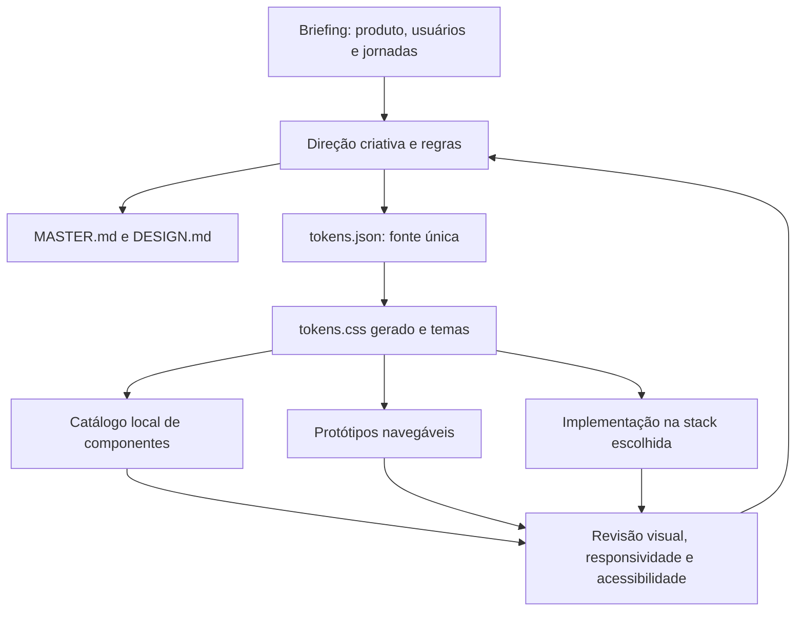

# Design systems e protótipos locais

O scaffold inclui um fluxo próprio para briefing, direção criativa, tokens, temas, catálogo, prototipação e revisão. Ele funciona com arquivos do repositório e preserva a escolha posterior da stack. Não exige skills instaladas de outros repositórios, serviços de design, MCPs, credenciais, npm ou CDN. Os comandos de geração usam Node.js; a inspeção visual usa um navegador local. Este fluxo não altera os requisitos atuais dos demais geradores de aplicação do harness.

## Começar

```text
$design-system criar a linguagem visual a partir do briefing e das jornadas do produto
$screen-prototype prototipar a jornada descrita em docs/F01-exemplo/spec.md
$frontend-ui-design avaliar o protótipo e registrar problemas com evidências
```

Para preparar somente os arquivos de referência, sem definir a marca ou gerar uma aplicação:

```bash
node scripts/design-system.mjs init docs/design
```

Preencha o briefing e ajuste a direção visual, componentes e tokens. Depois de editar a fonte:

```bash
node scripts/design-system.mjs build docs/design
```

Abra `docs/design/catalog.html` em um navegador para observar os componentes. Para uma prévia HTTP em loopback, inclusive no navegador de testes:

```bash
node scripts/design-system.mjs preview docs
```

O comando informa a URL com porta livre; encerre com Ctrl+C. Ele serve os arquivos locais em `docs/`, incluindo os protótipos. Os estilos, comportamentos e fontes de sistema estão locais; não há requisições a serviços externos. Para revisão automatizada, use `playwright-cli` instalado e registre evidências. Ferramenta indisponível deixa a revisão pendente; geração dos fontes e revisão visual são verificações diferentes.

`init` aceita apenas destino novo ou vazio. `build` preserva os demais documentos e só escreve CSS depois de validar a estrutura dos tokens. O kit inicial é demonstrativo; o design do produto será definido a partir do briefing. Não gere o diretório de design automaticamente em projetos sem interface.

## Fluxo e fontes canônicas



| Artefato | Responsabilidade |
|---|---|
| `docs/design/MASTER.md` | Briefing, direção criativa, escolhas, hipóteses e pendências |
| `docs/design/DESIGN.md` | Regras de composição, interação, responsividade e consumo dos tokens |
| `docs/design/tokens.json` | Única fonte editável dos valores, aliases e temas |
| `docs/design/tokens.css` | Representação gerada em CSS variables |
| `docs/design/COMPONENTS.md` | Contratos, anatomia, variantes, estados e critérios dos componentes |
| `docs/design/components.css` e `catalog.html` | Estilos compartilhados e catálogo interativo local |
| `docs/FXX-slug/prototype/` | Telas, roteiro, dados simulados, limites e evidências da feature |

Sem feature definida, use `docs/design/prototypes/<slug>/`. Ajuste os links relativos dos protótipos para consumir os mesmos estilos e tokens. A implementação pode usar adaptadores para outro formato, gerados da fonte canônica; documente a transformação e verifique equivalência. Valores duplicados em ferramentas ou telas não passam a ser fontes alternativas.

O compilador verifica nomes, aliases ausentes, ciclos, colisões de nomes CSS e cobertura das chaves de temas. Ele não mede contraste, não valida toda a gramática CSS e não certifica acessibilidade. O formato JSON é local ao scaffold; integrações com formatos de outras ferramentas exigem conversão explícita.

## Combinações por objetivo

As combinações externas abaixo foram fornecidas como referências de organização do trabalho. As skills e templates próprios deste scaffold cobrem o fluxo local, sem instalar ou reproduzir integralmente esses produtos.

| Objetivo | Combinação de referência fornecida | Caminho autocontido |
|---|---|---|
| Criar design systems diretamente em código | UI UX Pro Max + shadcn/ui + Storybook | `design-system`, tokens, contratos e catálogo HTML local |
| Gerar protótipos web rapidamente com IA | Stitch Skills + UI UX Pro Max | `design-system` + `screen-prototype` com arquivos editáveis |
| Criar componentes visuais editáveis | Penpot AI Kit ou Figma MCP | HTML/CSS e componentes locais editáveis; uso de editor visual depende de integração escolhida |
| Criar interfaces visualmente diferenciadas | Frontend Design + Impeccable | Direção criativa a partir do briefing + `frontend-ui-design` com crítica e evidências |
| Criar um SaaS completo com consistência | UI UX Pro Max + Frontend Design + shadcn/ui + 21st.dev + Impeccable + Storybook | Design system compartilhado, jornadas prototipadas, componentes e implementação/avaliação por contrato |

## Responsabilidades locais

- **Inteligência de design:** relacionar público, contexto, densidade, tipografia, cor, conteúdo e interação às jornadas; documentar os motivos.
- **Direção criativa:** escolher composição e linguagem visual específicas para o produto, usando referências fornecidas e evitando repetir um template como identidade universal.
- **Prototipação:** demonstrar a tarefa principal e estados pertinentes com dados simulados identificados. Ações apresentadas como funcionais precisam demonstrar sua transição.
- **Catálogo:** expor componentes, variantes e estados, incluindo teclado, foco, validação, desabilitado, mensagens e diálogo quando aplicáveis.
- **Crítica e refinamento:** revisar aderência aos tokens, hierarquia, contraste medido, responsividade, textos longos, zoom, movimento reduzido e acessibilidade de interação. Separar achado confirmado de hipótese e registrar evidências.

## Após escolher a stack

Adapte os tokens e os contratos à tecnologia definida. shadcn/ui e a combinação React citada são opções associadas a uma escolha específica; a prototipação local não determina o framework da aplicação. Storybook ou outra ferramenta de catálogo pode ser incorporada depois, com histórias e testes para os estados definidos. A adoção dessas ferramentas é uma decisão própria da fundação.

O scaffold não executa os comandos de instalação global, `npx skills add`, instalação do Impeccable, configuração pessoal de MCP ou conexão ao Stitch/Figma/Penpot. Se uma integração externa for solicitada, preserve os tokens canônicos, identifique a direção de sincronização, confira divergências e mantenha os artefatos locais utilizáveis. Credenciais ficam no ambiente.

## Evidências de entrega

A entrega registra caminhos, direção definida, tokens e temas usados, telas e estados demonstrados, limites dos mocks e verificações efetivamente realizadas. Reveja no navegador em tamanhos estreito e amplo e nos temas adotados. Guarde screenshots e roteiro junto da feature. Uma avaliação estética não substitui o contrato funcional; pendências de interação, contraste ou integração continuam explícitas.
